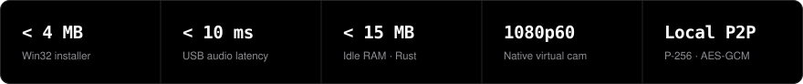
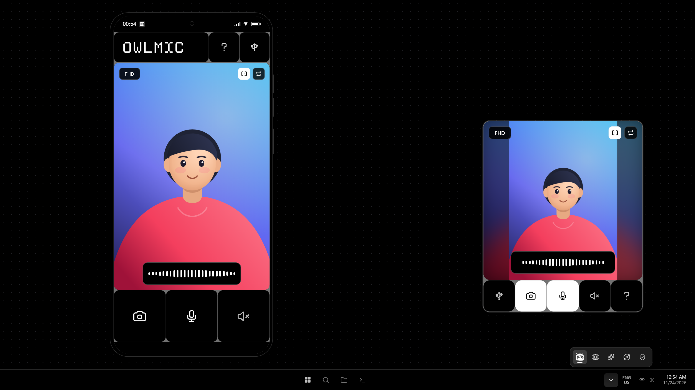
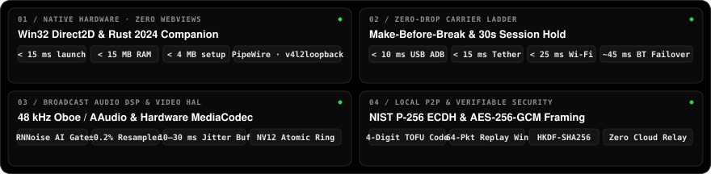
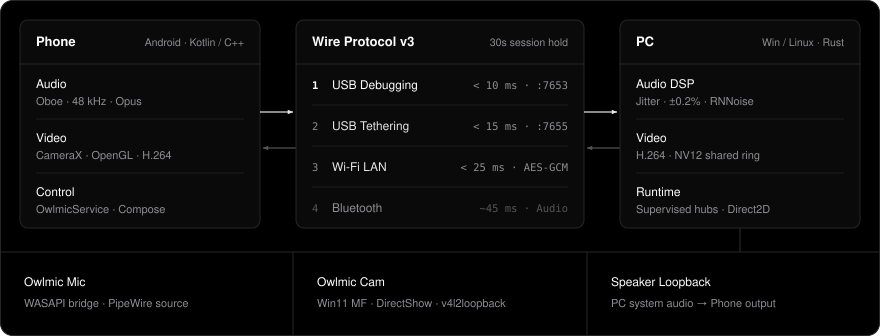
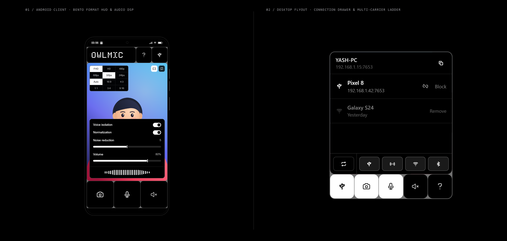
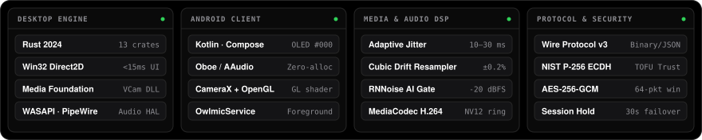

<div align="center">
  <br />
  <picture>
    <source media="(prefers-color-scheme: dark)" srcset="shared/assets/readme/wordmark-dark.svg" />
    <source media="(prefers-color-scheme: light)" srcset="shared/assets/readme/wordmark-light.svg" />
    
  </picture>

  <br /><br />

  <p><strong>Your Android phone is your PC's studio microphone, 1080p60 webcam, and low-latency speaker.</strong></p>

  <p>
    <a href="https://github.com/diveshpatil9104/owlmic/releases">Download v0.1.0</a>
    &nbsp;&middot;&nbsp;
    <a href="https://owlmic.com">Website</a>
    &nbsp;&middot;&nbsp;
    <a href="docs/README.md">Documentation</a>
    &nbsp;&middot;&nbsp;
    <a href="docs/technical/protocol.md">Protocol v3</a>
    &nbsp;&middot;&nbsp;
    <a href="https://github.com/diveshpatil9104/owlmic/discussions">Discussions</a>
  </p>
</div>

<br />

<div align="center">
  
</div>

<br />

<div align="center">
  
</div>

<br />

<div align="center">
  
</div>

<br />

---

## Why Owlmic

<div align="center">
  
</div>

<br />

- **Native Hardware, Zero WebViews** &mdash; Rust 2024 engine across 13 crates using `std::thread` and bounded mailboxes. Win32 Direct2D flyout opens in `< 15 ms`, idles `< 15 MB` RAM, sub-4 MB installer. Native PipeWire, `v4l2loopback`, and KSNI on Linux.
- **Zero-Drop Carrier Ladder** &mdash; Plug in USB mid-call and live audio/video migrates off Wi-Fi without dropping a sample (**Make-Before-Break**). 30-second **Session Hold** keeps virtual device handles alive during failover.
- **Studio Audio DSP & Hardware Video** &mdash; 48 kHz C++ Oboe/AAudio, adaptive jitter buffer (10–30 ms), `±0.2%` cubic drift resampler, RNNoise AI suppression, and soft-knee limiter. OpenGL ES shader into hardware `MediaCodec` H.264 and atomic NV12 shared ring buffer.
- **Strict Local P2P & Cryptographic Trust** &mdash; Zero cloud relays, zero accounts, zero telemetry. TOFU pairing via NIST P-256 ECDH, HKDF-SHA256, 4-digit safety code, and AES-256-GCM authenticated encryption.

---

## Architecture & Transport Ladder

<div align="center">
  
</div>

<br />

The phone is always the client (`OwlmicService`), and the PC is always the server listening on TCP `7653` (control + ADB media), UDP `7654` (discovery), and UDP `7655` (media datagrams).

| Priority | Carrier | Latency | Audio / Video | Security | Best For |
| :---: | :--- | :---: | :--- | :--- | :--- |
| **1** | **USB Debugging** (`adb reverse`) | `< 10 ms` | 48 kHz PCM &middot; 1080p60 | P-256 Handshake | Streaming, studio recording, esports |
| **2** | **USB Tethering** (RNDIS / NCM) | `< 15 ms` | 48 kHz PCM &middot; 1080p60 | P-256 Handshake | Everyday wired zero-config connection |
| **3** | **Wi-Fi LAN / Hotspot** | `< 25 ms` | Opus 48 kbps + FEC &middot; 1080p60 | AES-256-GCM | Desk and room wireless mobility |
| **4** | **Bluetooth RFCOMM** | `~45 ms` | Opus 24 kbps (audio only) | AES-256-GCM | Wireless audio failover |

---

## Technical Interface & Audio DSP

<div align="center">
  
</div>

<br />

Bidirectional control synchronizes format, lens, and audio DSP settings instantly over Protocol v3. If a Windows OS update ever disrupts virtual device registration, click **Repair** in the tray flyout for single-UAC automated recovery.

---

## Engineering Tech Stack

<div align="center">
  
</div>

<br />

| Subsystem | Stack | Architecture Highlights |
| :--- | :--- | :--- |
| **Desktop Core** | Rust 2024 (13 workspace crates) | Supervised `std::thread` hubs, bounded mailboxes, zero Tokio in core |
| **Desktop UI** | Win32 Direct2D / GDI &middot; Linux KSNI | `< 15 ms` flyout launch, 1px hairline Bento layout, zero Electron/WebView |
| **Virtual Hardware** | WASAPI &middot; Win11 MF (`owlmic_vcam.dll`) &middot; Win10 DS &middot; PipeWire &middot; `v4l2loopback` | Lock-free atomic NV12 shared ring buffer, `MFCreateVirtualCamera` |
| **Android Client** | Kotlin &middot; Jetpack Compose &middot; C++ JNI | Pure `#000000` OLED UI, zero-alloc Oboe/AAudio capture, CameraX + OpenGL ES |
| **Media & DSP** | `libopus` &middot; `nnnoiseless` (RNNoise) &middot; Hardware `MediaCodec` | Adaptive jitter buffer, `±0.2%` cubic drift resampler, `KEEP_ONLY_LATEST` video |
| **Protocol & Trust** | Wire Protocol v3 &middot; NIST P-256 &middot; HKDF-SHA256 &middot; AES-256-GCM | Canonical JSON + binary framing verified by shared cross-platform vectors |

---

## Quick Start

1. **Install**
   - **Windows 10 / 11:** Run [`Owlmic-Setup-0.1.0.exe`](https://github.com/diveshpatil9104/owlmic/releases) (silent notification tray companion).
   - **Linux:** Extract tarball from [Releases](https://github.com/diveshpatil9104/owlmic/releases) and enable `systemctl --user enable --now owlmic.service`. See [`install-linux.md`](docs/user/install-linux.md).
   - **Android (8.0+):** Install the APK from [Releases](https://github.com/diveshpatil9104/owlmic/releases).

2. **Connect**
   - Plug USB cable (**USB Tethering** or **USB Debugging** for `< 15 ms` uncompressed audio), or connect to the same Wi-Fi.

3. **Pair & Select Hardware**
   - Open Owlmic on Android. Confirm the 4-digit code on PC and tap **Allow**.
   - Select **Owlmic Mic** and **Owlmic Cam** in Discord, OBS, Zoom, Teams, or Meet.

---

## Build from Source

All desktop, Android, invariant, and packaging workflows run through standard library Python 3 (`scripts/menu.py`):

```bash
git clone --recurse-submodules https://github.com/diveshpatil9104/owlmic.git
cd owlmic

# Interactive dashboard
python scripts/menu.py

# Direct CLI targets
python scripts/menu.py build windows   # -> releases/Owlmic-Setup-0.1.0.exe
python scripts/menu.py build linux     # -> releases/Owlmic-v0.1.0-linux-x86_64.tar.gz
python scripts/menu.py build android   # -> releases/Owlmic-v0.1.0.apk
python scripts/menu.py check           # Invariants + rustfmt/clippy/test + Android lint
```

Packaging dependencies (`VB-CABLE` and `softcam.dll`) are SHA-256 pinned in `scripts/packaging/windows/dependencies.json` for reproducible builds. Full prerequisites are in [`docs/technical/building.md`](docs/technical/building.md).

---

## Documentation

| End Users | Technical Specifications |
| :--- | :--- |
| [Install on Windows](docs/user/install-windows.md) &middot; [Linux](docs/user/install-linux.md) &middot; [Android](docs/user/install-android.md) | [System Architecture](docs/technical/architecture.md) &middot; [Transporter](docs/technical/transporter.md) |
| [First Connection & TOFU Pairing](docs/user/first-connection.md) | [Wire Protocol v3](docs/technical/protocol.md) &middot; [Security & Crypto](docs/technical/security.md) |
| [Connection Levels & Switching](docs/user/connection-levels.md) | [Audio & Video Media Pipelines](docs/technical/media.md) |
| [Everyday Use](docs/user/everyday-use.md) &middot; [Troubleshooting](docs/user/troubleshooting.md) | [Virtual Devices](docs/technical/virtual-devices.md) &middot; [Design Language](docs/technical/design-language.md) |

Browse the complete documentation in [`docs/README.md`](docs/README.md) or see [`CONTRIBUTING.md`](.github/CONTRIBUTING.md) to contribute.

---

<p align="center">
  Licensed under the <a href="LICENSE">MIT License</a> &middot;
  Third-party notices (<a href="scripts/packaging/windows/THIRD-PARTY-NOTICES.txt">VB-CABLE, softcam, RNNoise, Opus</a>)
</p>
